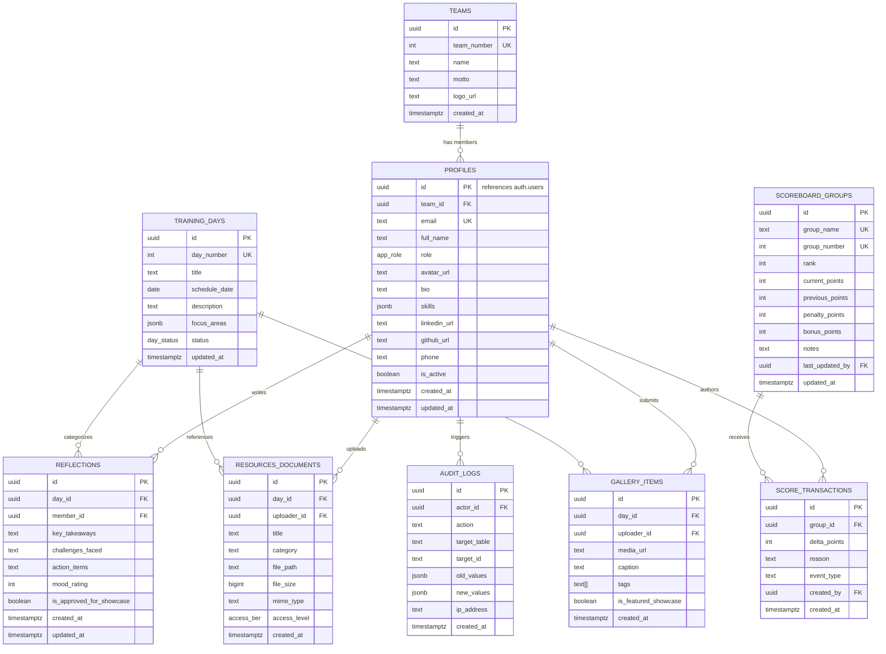

# ZENITH — Team No. 5 | Database Design & Entity Specification

| **Document Version** | 1.0.0 |
| **Status** | Approved for Architecture / Pending Implementation |
| **Engine** | PostgreSQL 15+ (Supabase) |

---

## 1. Entity-Relationship Overview



---

## 2. Enumerated Types (Enums)

```sql
-- Role-based privilege tier
CREATE TYPE app_role AS ENUM (
    'team_admin',
    'captain',
    'vice_captain',
    'member'
);

-- Operational status for training days
CREATE TYPE day_status AS ENUM (
    'upcoming',
    'in_progress',
    'completed'
);

-- File access classification
CREATE TYPE access_tier AS ENUM (
    'internal_only',
    'showcase_public'
);
```

---

## 3. Detailed Table Definitions & Constraints

### 3.1 `teams`
Contains the authoritative master metadata for Team No. 5 (ZENITH).

| Column | Type | Constraints | Description |
| :--- | :--- | :--- | :--- |
| `id` | `uuid` | `PRIMARY KEY DEFAULT gen_random_uuid()` | Unique team identifier |
| `team_number` | `int` | `NOT NULL UNIQUE CHECK (team_number > 0)` | Official cohort team index (5 for ZENITH) |
| `name` | `text` | `NOT NULL DEFAULT 'ZENITH'` | Team official brand name |
| `motto` | `text` | `NOT NULL DEFAULT '[Pending Official Motto]'` | Team slogan / vision placeholder |
| `logo_url` | `text` | `NULL` | URL to vector/raster team logo asset |
| `created_at` | `timestamptz` | `NOT NULL DEFAULT now()` | Row insertion timestamp |

### 3.2 `profiles`
Represents the strictly 8 provisioned team members, bound 1-to-1 to `auth.users`.

| Column | Type | Constraints | Description |
| :--- | :--- | :--- | :--- |
| `id` | `uuid` | `PRIMARY KEY REFERENCES auth.users(id) ON DELETE CASCADE` | Matches Supabase Auth user ID |
| `team_id` | `uuid` | `NOT NULL REFERENCES teams(id)` | Associated team |
| `email` | `text` | `NOT NULL UNIQUE` | Official institutional email |
| `full_name` | `text` | `NOT NULL DEFAULT '[Candidate Name Pending]'` | Member's verified name |
| `role` | `app_role` | `NOT NULL DEFAULT 'member'` | RBAC privilege tier |
| `avatar_url` | `text` | `NULL` | Profile portrait path in Storage |
| `bio` | `text` | `NULL DEFAULT '[Candidate Bio Pending]'` | Professional summary |
| `skills` | `jsonb` | `NOT NULL DEFAULT '[]'::jsonb` | Structured array of acquired competencies |
| `linkedin_url`| `text` | `NULL` | Public LinkedIn profile |
| `github_url`  | `text` | `NULL` | Public GitHub profile |
| `phone`       | `text` | `NULL DEFAULT '[Verified Contact Pending]'` | Emergency/team contact |
| `is_active`   | `boolean`| `NOT NULL DEFAULT true` | Account active flag |
| `created_at`  | `timestamptz`| `NOT NULL DEFAULT now()` | Profile creation |
| `updated_at`  | `timestamptz`| `NOT NULL DEFAULT now()` | Last update timestamp |

### 3.3 `scoreboard_groups`
Stores real-time leaderboard statistics for all participating groups in the mPOWER competition.

| Column | Type | Constraints | Description |
| :--- | :--- | :--- | :--- |
| `id` | `uuid` | `PRIMARY KEY DEFAULT gen_random_uuid()` | Group identifier |
| `group_name` | `text` | `NOT NULL UNIQUE` | Display name (e.g. 'ZENITH (Team 5)', 'Alpha') |
| `group_number` | `int` | `NOT NULL UNIQUE` | Cohort group number (1 to N) |
| `rank` | `int` | `NOT NULL DEFAULT 1 CHECK (rank > 0)` | Dynamically computed rank |
| `current_points` | `int`| `NOT NULL DEFAULT 0` | Total cumulative competition points |
| `previous_points`| `int`| `NOT NULL DEFAULT 0` | Previous session score (for trend indicators) |
| `penalty_points` | `int`| `NOT NULL DEFAULT 0 CHECK (penalty_points >= 0)` | Deducted penalty points |
| `bonus_points`   | `int`| `NOT NULL DEFAULT 0 CHECK (bonus_points >= 0)` | Extra credit points earned |
| `notes` | `text` | `NULL` | Remarks on group standing |
| `last_updated_by`| `uuid` | `NULL REFERENCES profiles(id)` | Author of last score modification |
| `updated_at` | `timestamptz` | `NOT NULL DEFAULT now()` | Timestamp of last adjustment |

### 3.4 `score_transactions`
Immutable ledger capturing every score alteration made by Captain or Vice-Captain.

| Column | Type | Constraints | Description |
| :--- | :--- | :--- | :--- |
| `id` | `uuid` | `PRIMARY KEY DEFAULT gen_random_uuid()` | Transaction identifier |
| `group_id` | `uuid` | `NOT NULL REFERENCES scoreboard_groups(id) ON DELETE CASCADE` | Affected group |
| `delta_points` | `int` | `NOT NULL CHECK (delta_points <> 0)` | Signed points (+50, -10) |
| `reason` | `text` | `NOT NULL CHECK (char_length(reason) >= 3)` | Mandatory justification |
| `event_type` | `text` | `NOT NULL DEFAULT 'manual_adjustment'` | Activity category |
| `created_by` | `uuid` | `NOT NULL REFERENCES profiles(id)` | Adjusting user ID |
| `created_at` | `timestamptz` | `NOT NULL DEFAULT now()` | Transaction timestamp |

### 3.5 `training_days`
Catalog of the 4-day placement curriculum.

| Column | Type | Constraints | Description |
| :--- | :--- | :--- | :--- |
| `id` | `uuid` | `PRIMARY KEY DEFAULT gen_random_uuid()` | Day record ID |
| `day_number` | `int` | `NOT NULL UNIQUE CHECK (day_number BETWEEN 1 AND 4)` | Index 1 to 4 |
| `title` | `text` | `NOT NULL` | Session title |
| `schedule_date` | `date` | `NOT NULL` | Scheduled date |
| `description` | `text` | `NOT NULL` | Curriculum summary |
| `focus_areas` | `jsonb` | `NOT NULL DEFAULT '[]'::jsonb` | Modules covered |
| `status` | `day_status`| `NOT NULL DEFAULT 'upcoming'` | Lifecycle state |
| `updated_at` | `timestamptz` | `NOT NULL DEFAULT now()` | Last update timestamp |

### 3.6 `reflections`
Daily experiential logs submitted by the 8 team members.

| Column | Type | Constraints | Description |
| :--- | :--- | :--- | :--- |
| `id` | `uuid` | `PRIMARY KEY DEFAULT gen_random_uuid()` | Reflection identifier |
| `day_id` | `uuid` | `NOT NULL REFERENCES training_days(id) ON DELETE CASCADE` | Associated day |
| `member_id` | `uuid` | `NOT NULL REFERENCES profiles(id) ON DELETE CASCADE` | Submitting member |
| `key_takeaways` | `text` | `NOT NULL CHECK (char_length(key_takeaways) >= 10)` | Core learnings |
| `challenges_faced` | `text` | `NULL` | Hurdles encountered |
| `action_items` | `text` | `NULL` | Corrective steps |
| `mood_rating` | `int` | `NOT NULL CHECK (mood_rating BETWEEN 1 AND 5)` | 1 (Challenged) to 5 (Mastered) |
| `is_approved_for_showcase` | `boolean` | `NOT NULL DEFAULT false` | Flag for evaluator portal visibility |
| `created_at` | `timestamptz` | `NOT NULL DEFAULT now()` | Submission timestamp |
| `updated_at` | `timestamptz` | `NOT NULL DEFAULT now()` | Revision timestamp |

### 3.7 `resources_documents`
Reference materials, notes, and cheat sheets.

| Column | Type | Constraints | Description |
| :--- | :--- | :--- | :--- |
| `id` | `uuid` | `PRIMARY KEY DEFAULT gen_random_uuid()` | Document ID |
| `day_id` | `uuid` | `NULL REFERENCES training_days(id)` | Optional day association |
| `uploader_id` | `uuid` | `NOT NULL REFERENCES profiles(id)` | Uploader ID |
| `title` | `text` | `NOT NULL` | Document title |
| `category` | `text` | `NOT NULL DEFAULT 'General'` | Aptitude / Tech / Interview |
| `file_path` | `text` | `NOT NULL` | Path in Supabase Storage |
| `file_size` | `bigint` | `NOT NULL CHECK (file_size > 0)` | Byte count |
| `mime_type` | `text` | `NOT NULL` | PDF, DOCX, PNG, etc. |
| `access_level` | `access_tier`| `NOT NULL DEFAULT 'internal_only'` | Internal vs Public |
| `created_at` | `timestamptz` | `NOT NULL DEFAULT now()` | Upload timestamp |

### 3.8 `gallery_items`
Visual media capturing training highlights.

| Column | Type | Constraints | Description |
| :--- | :--- | :--- | :--- |
| `id` | `uuid` | `PRIMARY KEY DEFAULT gen_random_uuid()` | Gallery item ID |
| `day_id` | `uuid` | `NULL REFERENCES training_days(id)` | Optional day link |
| `uploader_id` | `uuid` | `NOT NULL REFERENCES profiles(id)` | Member who took the picture |
| `media_url` | `text` | `NOT NULL` | Public or authenticated asset URL |
| `caption` | `text` | `NULL` | Description of milestone |
| `tags` | `text[]` | `NOT NULL DEFAULT '{}'` | Search tags |
| `is_featured_showcase`| `boolean` | `NOT NULL DEFAULT false` | Shown on evaluator site |
| `created_at` | `timestamptz` | `NOT NULL DEFAULT now()` | Creation timestamp |

### 3.9 `audit_logs`
Security and operational audit history.

| Column | Type | Constraints | Description |
| :--- | :--- | :--- | :--- |
| `id` | `uuid` | `PRIMARY KEY DEFAULT gen_random_uuid()` | Audit log ID |
| `actor_id` | `uuid` | `NULL REFERENCES profiles(id)` | Acting user |
| `action` | `text` | `NOT NULL` | INSERT, UPDATE, DELETE, SCORE_EDIT |
| `target_table` | `text` | `NOT NULL` | Name of modified table |
| `target_id` | `text` | `NOT NULL` | Primary key of modified record |
| `old_values` | `jsonb` | `NULL` | Prior record state |
| `new_values` | `jsonb` | `NULL` | Resulting record state |
| `ip_address` | `text` | `NULL` | Client IP |
| `created_at` | `timestamptz` | `NOT NULL DEFAULT now()` | Log timestamp |

---

## 4. Stored Procedures, Functions & Triggers

### 4.1 Automatic Rank Recalculation Stored Procedure
Whenever scores change in `scoreboard_groups`, this procedure recalibrates ordinal rankings according to total net points ($(\text{current\_points} + \text{bonus\_points}) - \text{penalty\_points}$).

```sql
CREATE OR REPLACE FUNCTION recalculate_scoreboard_ranks()
RETURNS TRIGGER AS $$
BEGIN
    WITH ranked AS (
        SELECT id, DENSE_RANK() OVER (
            ORDER BY (current_points + bonus_points - penalty_points) DESC, group_number ASC
        ) as new_rank
        FROM scoreboard_groups
    )
    UPDATE scoreboard_groups sg
    SET rank = ranked.new_rank
    FROM ranked
    WHERE sg.id = ranked.id AND sg.rank IS DISTINCT FROM ranked.new_rank;

    RETURN NEW;
END;
$$ LANGUAGE plpgsql SECURITY DEFINER;
```

### 4.2 Secure Atomic Score Adjustment RPC
Ensures score changes and transaction entries occur within a single atomic database transaction, restricted strictly to Captain and Vice-Captain roles:

```sql
CREATE OR REPLACE FUNCTION adjust_group_score(
    p_group_id UUID,
    p_delta_points INT,
    p_reason TEXT,
    p_event_type TEXT DEFAULT 'competition_adjustment'
)
RETURNS scoreboard_groups AS $$
DECLARE
    v_caller_role app_role;
    v_updated_group scoreboard_groups;
BEGIN
    -- Verify caller role
    SELECT role INTO v_caller_role
    FROM profiles
    WHERE id = auth.uid();

    IF v_caller_role NOT IN ('captain', 'vice_captain', 'team_admin') THEN
        RAISE EXCEPTION 'Access Denied: Only Captain, Vice-Captain, or Team Admin can modify scores.';
    END IF;

    -- Update group points
    UPDATE scoreboard_groups
    SET previous_points = current_points,
        current_points = current_points + p_delta_points,
        last_updated_by = auth.uid(),
        updated_at = now()
    WHERE id = p_group_id
    RETURNING * INTO v_updated_group;

    -- Log transaction
    INSERT INTO score_transactions (
        group_id,
        delta_points,
        reason,
        event_type,
        created_by
    ) VALUES (
        p_group_id,
        p_delta_points,
        p_reason,
        p_event_type,
        auth.uid()
    );

    RETURN v_updated_group;
END;
$$ LANGUAGE plpgsql SECURITY DEFINER;
```
