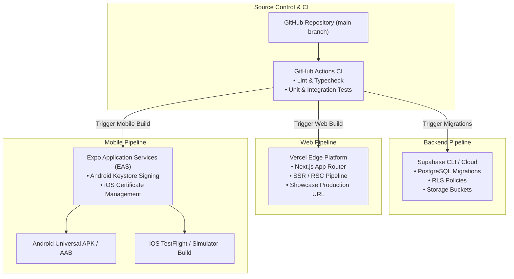

# ZENITH — Team No. 5 | Deployment & Release Plan

| **Document Version** | 1.0.0 |
| **Status** | Approved for Architecture / Pending Implementation |
| **Platforms** | Android (APK/AAB via EAS), iOS (IPA via EAS), Web Showcase (Vercel), Backend (Supabase Cloud) |

---

## 1. Production Topology & Deployment Pipeline



---

## 2. Infrastructure Specifications

### 2.1 Backend: Supabase Cloud
- **Tier:** Supabase Cloud Project (PostgreSQL 15+).
- **Network & Region:** AWS ap-south-1 (Mumbai) or region closest to university cohort for sub-50ms latency.
- **Authentication Configuration:**
  - `enable_signup = false` (Strict closed provisioning).
  - Minimum password length: 8 characters.
  - JWT Expiration: 3600 seconds (1 hour); Refresh token validity: 30 days.
- **Storage Buckets:**
  - `documents`: Private, restricted to authenticated JWT.
  - `gallery`: Public read, authenticated write.
  - `avatars`: Public read, member-scoped write.

### 2.2 Mobile Client: Expo & EAS Build
- **Build Engine:** Expo Application Services (EAS Build).
- **Profiles (`eas.json`):**
  - `development`: Internal test client with Expo Go / dev client support.
  - `preview`: Standalone Android Universal APK and iOS Simulator build for immediate device installation without App Store/Play Store gating.
  - `production`: Optimized Android App Bundle (`.aab`) and iOS `.ipa` for distribution.

### 2.3 Companion Web Showcase: Vercel
- **Framework Preset:** Next.js.
- **Routing:** App Router (`/`, `/journey`, `/team`, `/gallery`, `/report`).
- **Edge CDN:** Vercel Global Edge Network with automated SSL certificates.
- **Environment Integration:** Bound to Supabase production URL and anonymous key.

---

## 3. Step-by-Step Deployment Procedure

### Step 1: Backend Infrastructure Initialization
1. Create a Supabase project via the Supabase Dashboard.
2. Link the local repository using `supabase link --project-ref <project-id>`.
3. Apply schema migrations:
   ```bash
   npx supabase db push
   ```
4. Verify RLS policies and table structures in the Supabase Table Editor.
5. Create the 3 storage buckets (`documents`, `gallery`, `avatars`) and execute storage RLS scripts.
6. Run the seed script to provision the 8 member credentials and initialize competition groups:
   ```bash
   npx supabase db reset --seed
   ```

### Step 2: Companion Web Showcase Deployment (Vercel)
1. Import the repository into Vercel and set the Root Directory to `apps/showcase`.
2. Configure Environment Variables in the Vercel Dashboard:
   - `NEXT_PUBLIC_SUPABASE_URL`: Supabase Project URL.
   - `NEXT_PUBLIC_SUPABASE_ANON_KEY`: Supabase Anonymous Public Key.
   - `NEXT_PUBLIC_SHOWCASE_BASE_URL`: Evaluator portal domain.
3. Trigger deployment and verify that the public dashboard resolves cleanly.

### Step 3: Mobile Client Build & Signing (EAS)
1. Install EAS CLI globally: `npm install -g eas-cli`.
2. Login to Expo account: `eas login`.
3. Initialize project linking: `cd apps/mobile && eas init`.
4. Configure environment variables in EAS Secrets:
   ```bash
   eas secret:create --name EXPO_PUBLIC_SUPABASE_URL --value <SUPABASE_URL> --type string
   eas secret:create --name EXPO_PUBLIC_SUPABASE_ANON_KEY --value <SUPABASE_ANON_KEY> --type string
   ```
5. Trigger Android Preview APK build (installable directly on physical Android phones):
   ```bash
   eas build --platform android --profile preview
   ```
6. Download the generated `.apk` and install it on the presentation devices.

---

## 4. Rollback & Emergency Continuity Plan

1. **Database Rollback:** All migration files use idempotent DDL. Rollbacks are managed via sequential down-migrations. Supabase PITR provides instant restoration to any point within the preceding 7 days.
2. **Web Showcase Instant Rollback:** Vercel instantaneous deployment rollback allows reverting to any prior deployment hash with a single click.
3. **Mobile Client Stability:** Standalone preview APKs are distributed directly to demo devices ahead of time, insulating the presentation from live app store review delays.
