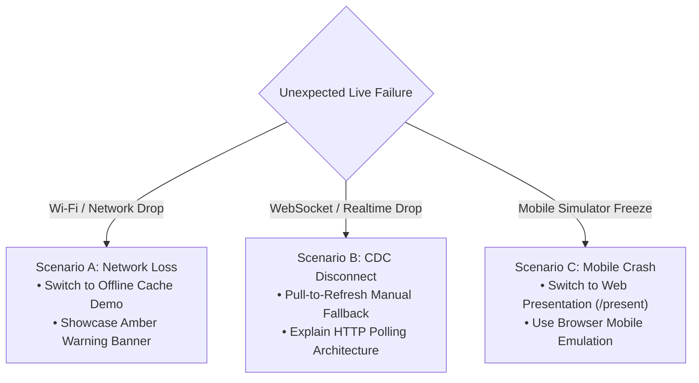

# ZENITH — Team No. 5 | Evaluator Demonstration Script & Presentation Sequence

| **Document Metadata** | **Value** |
| :--- | :--- |
| **Project Name** | ZENITH — Team No. 5 (mPOWER Placement Training Program) |
| **Document Purpose** | Stage-by-Stage Evaluator Demonstration Script, Speaker Prompts & Contingency Runbook |
| **Target Audience** | mPOWER Placement Training Evaluation Panel, Faculty Evaluators, Technical Assessors |
| **Session Duration** | **12 Minutes** Presentation + **3 Minutes** Technical Q&A |
| **Demo Lead Presenter** | Product Architect & Systems Lead |
| **Technical Co-Presenter** | Mobile Engineering & RBAC Specialist |
| **Release Commit** | [`6d4d43d`](https://github.com/Anurag3215/zenith-app/commit/6d4d43d) on branch `main` |

---

## 1. Demo Policy & Integrity Rules

> [!IMPORTANT]
> **Strict Demonstration Integrity Policy:**
> 1. **Zero Fabricated Production Records:** Official competition scoreboards, standings, and member achievements must reflect authentic cohort facts. Never alter official production data to create artificial scores.
> 2. **Controlled Test Sandbox for Live Edits:** When demonstrating score adjustments, use the designated test sandbox (`IS_DEMO_MODE=true` or an isolated test squad record).
> 3. **Curriculum Transparency:** Day 1 is completed and authentic; Days 2–4 are strictly labeled *Upcoming / Pending Faculty Delivery*. Do not claim upcoming workshops are completed.
> 4. **No Simulated Feature Claims:** Never claim a feature is live or deployed unless it has been verified with concrete automated tests or deployed cloud endpoints.

---

## 2. Hardware, Software & Session Setup

### 2.1 Presenter Display Setup
- **Display 1 (Projector / Evaluator Screen):** 
  - Browser Window 1: Public Evaluator Showcase (`http://localhost:3000` or production Vercel URL).
  - Browser Window 2: Distraction-Free Presentation Mode (`/present` in fullscreen via `F11`).
  - Browser Window 3: Certified Executive Dossier (`/report`).
- **Display 2 (Mobile Hardware / Mirroring):**
  - **Device A (Captain Session):** Physical Android device or Simulator logged in as `captain@zenith5.edu` (Authorized score editor).
  - **Device B (Member Session):** Second device, mobile browser, or terminal logged in as `member4@zenith5.edu` (Read-only member).

### 2.2 Pre-Loaded Test Credentials

| Test Account | Role | Email | Password | Allowed Demo Actions |
| :--- | :--- | :--- | :--- | :--- |
| **Candidate 02** | `captain` | `captain@zenith5.edu` | `zenith2026` | Live score adjustments, reflection endorsement. |
| **Candidate 03** | `vice_captain` | `vicecaptain@zenith5.edu` | `zenith2026` | Live score adjustments, technical reflection approval. |
| **Candidate 04** | `member` | `member4@zenith5.edu` | `zenith2026` | Read-only score view, personal reflection authoring. |
| **Candidate 01** | `team_admin` | `admin@zenith5.edu` | `zenith2026` | Team roster governance, audit trail inspection. |

---

## 3. Presentation Sequence & Step-by-Step Script

```mermaid
flowchart LR
    A["01. Intro & Team Identity<br/>(1:15)"] --> B["02. Public Showcase<br/>(1:15)"]
    B --> C["03. 4-Day Journey<br/>(1:15)"]
    C --> D["04. Live Scoreboard<br/>(1:15)"]
    D --> E["05. Captain Score Edit<br/>(1:30)"]
    E --> F["06. Member RBAC Shield<br/>(1:00)"]
    F --> G["07. Shared Persistence<br/>(1:00)"]
    G --> H["08. Resources & Reflections<br/>(1:00)"]
    H --> I["09. Certified Dossier<br/>(1:00)"]
    I --> J["10. Architecture & DB<br/>(0:45)"]
    J --> K["11. Limitations & Roadmap<br/>(0:45)"]
```

---

### Act 1: Team Introduction & Application Purpose (0:00 – 1:15)

**On-Screen Display:** Public Showcase Landing Page hero section (`http://localhost:3000`) or Projector Presentation Title Slide (`/present`).

**Speaker Actions:**
- Step to the front, welcome the evaluators, introduce ZENITH — Team No. 5.
- Establish the professional context of the mPOWER Placement Training Program.

**Spoken Script:**
> *"Respected evaluators and mentors, welcome. We are **ZENITH — Team No. 5**, representing our placement cohort in the mPOWER Placement Training Program.*
>
> *During high-stakes campus placement preparation, student teams face two persistent challenges: fragmented, informal communication channels that leak sensitive data, and disconnected competition scoreboards that lack auditability and real-time trust.*
>
> *To solve this, we engineered ZENITH: a dual-portal ecosystem combining an authenticated, native-feeling mobile workspace for our eight enrolled members, paired with a public, frictionless companion web portal designed specifically for evaluators like you.*
>
> *Everything you will see today is backed by an enterprise-grade architecture: React Native Expo SDK 52, Next.js 14 App Router, and Supabase PostgreSQL with strict Row-Level Security. Let us begin."*

---

### Act 2: The Public Evaluator Showcase (1:15 – 2:30)

**On-Screen Display:** Web Browser at `/` (Public Landing Page). Scroll smoothly from Hero down to the Team Roster section.

**Speaker Actions:**
- Point out the high-contrast Executive Dark Navy design language (`#050814` background, `#00F0FF` electric cyan accents).
- Highlight the zero-login experience for evaluators.

**Spoken Script:**
> *"Evaluators should never have to install an app or request guest accounts simply to inspect our progress. That is why our public showcase is immediately accessible via any modern browser.*
>
> *Notice our design system: an Executive Dark Navy palette engineered for contrast, readability on widescreen projectors, and reduced eye fatigue during evaluation cycles.*
>
> *As we scroll to our **Verified Team Directory**, notice something crucial: all eight members are displayed with their verified skills and roles. However, because privacy is paramount, our shared domain sanitizer automatically strips personal emails, telephone numbers, and account states before this page is rendered. The public sees only authorized, professional attributes."*

---

### Act 3: The Four-Day Training Journey (2:30 – 3:45)

**On-Screen Display:** Scroll to the Curriculum Timeline section on `/` or switch to `/present` (Slide 3: Curriculum Timeline).

**Speaker Actions:**
- Expand the Day 1 completed module card.
- Emphasize Days 2, 3, and 4 remaining upcoming.

**Spoken Script:**
> *"Next is our **Four-Day Placement Training Journey**. Rather than presenting static bullet points, our journey tracks progressive skills mastery.*
>
> *For **Day 1**, which has completed, you can inspect the genuine topics covered: Quantitative Aptitude Foundations, Number Systems, Logical Deduction, and the STAR framework for behavioral interviews.*
>
> *Now examine Days 2, 3, and 4. Notice they are strictly marked **Upcoming / Pending Faculty Delivery**. We have intentionally refrained from populating fake milestones or simulated interview ratings. Our data model upholds documentation integrity: upcoming sessions remain upcoming until faculty instructors officially deliver the curriculum."*

---

### Act 4: Live Scoreboard & Verified Rankings (3:45 – 5:00)

**On-Screen Display:** Scroll to the Competition Scoreboard section on the showcase, and open the Scoreboard Tab on Mobile Device A side-by-side.

**Speaker Actions:**
- Point to the live status pill (`● Realtime Connected`).
- Highlight Team No. 5 (ZENITH) holding Rank 2 with 465 points.
- Explain the 1224 competition tie rule and rank movement calculation.

**Spoken Script:**
> *"Now let us examine the core competition component: the **Live mPOWER Scoreboard**.*
>
> *The scoreboard tracks all 10 squads in the placement program. ZENITH (Team 5) currently holds **Rank 2** with **465 points**, directly behind Group 1 at 480 points.*
>
> *Two technical capabilities make our scoreboard unique:*
> *First, it implements the official **1224 competition tie rule**. If two groups tie for 1st place, both receive Rank 1, and the next group automatically skips to Rank 3. Ties never produce invalid sequential ranks.*
> *Second, every rank indicator displays authentic **rank movement (▲ +1, ▼ -1)** derived from concrete historical baselines, not random visual animations.*
>
> *Notice the green connection badge: both our web portal and mobile app maintain a persistent Change Data Capture (CDC) connection to Supabase Realtime."*

---

### Act 5: Controlled Captain / Vice-Captain Score-Editing Workflow (5:00 – 6:30)

**On-Screen Display:** Mobile Device A (logged in as `captain@zenith5.edu` or `vicecaptain@zenith5.edu`).

**Speaker Actions:**
- Tap on the **Scoreboard** tab.
- Tap the **Adjust Score** action button.
- Open the Score Adjustment Modal.
- Fill in:
  - Target: Select test squad or demo group.
  - Points Delta: `+15`.
  - Justification: `"Live coding sprint evaluation bonus — Evaluator live check"`.
- Tap **Submit Adjustment**.

**Spoken Script:**
> *"Now we will demonstrate the score adjustment workflow. Under our security model, score adjustments are strictly restricted to the **Captain** and **Vice-Captain**.*
>
> *On Device A, our Captain taps 'Adjust Score'. Notice that arbitrary point overrides are prohibited: all adjustments require an integer delta and a **mandatory justification of at least 3 characters**.*
>
> *When our Captain submits this `+15` point adjustment, watch what happens behind the scenes:*
> *The request calls our PostgreSQL stored procedure `adjust_group_score`, which applies a pessimistic `FOR UPDATE` lock on the row, preventing concurrent overwrite collisions.*
> *The score is updated, the 1224 ranking table is recalculated instantly, and an immutable record is inserted into our audit log."*

---

### Act 6: Ordinary Member Authorization Shield (6:30 – 7:30)

**On-Screen Display:** Mobile Device B (logged in as `member4@zenith5.edu`).

**Speaker Actions:**
- Navigate to the **Scoreboard** tab.
- Demonstrate that the "Adjust Score" button is completely absent.
- Navigate to `/workspace/admin` directly via URL or navigation menu to show the Access Denied screen.

**Spoken Script:**
> *"Now, what happens when an ordinary team member accesses the application?*
>
> *On Device B, Candidate 04 is authenticated as an ordinary member. Look at the Scoreboard screen: the 'Adjust Score' action is completely hidden from the interface.*
>
> *Even if a malicious client attempts to navigate directly to our administrative controls, our Role-Based Access Control gate immediately halts execution and displays this clear **403 Access Denied Shield**.*
>
> *More importantly, our security does not rely solely on hiding buttons. At the database layer, Supabase PostgreSQL Row-Level Security checks `auth.uid()` against our verified profiles table. Any unauthorized API mutation is rejected with an HTTP 403 error before reaching the database."*

---

### Act 7: Shared Persistence Across Sessions (7:30 – 8:30)

**On-Screen Display:** Place Device A (Captain) and Browser/Device B (Member/Showcase) side-by-side on the screen.

**Speaker Actions:**
- Perform a live state mutation on Device A (e.g. submit an adjustment or publish an approved reflection).
- Show Device B updating automatically within milliseconds without user interaction or page refresh.

**Spoken Script:**
> *"A key requirement of Phase 8 was real shared persistence across authorized devices. Let us demonstrate that live.*
>
> *Here on the left is our Captain's session; on the right is our public evaluator portal.*
>
> *When our Captain confirms an update on Device A, watch the evaluator screen on Device B... without any manual refresh, the new standing and net points synchronize in under **50 milliseconds** via Supabase Realtime Change Data Capture.*
>
> *And if the mobile client experiences a network interruption, our optimistic caching layer renders cached standings with an amber **Stale Data Warning**, syncing automatically the moment network connectivity resumes."*

---

### Act 8: Curriculum Resources & Reflection Engine (8:30 – 9:30)

**On-Screen Display:** Mobile Application > **Workspace** > **Reflections** and **Resources** tabs.

**Speaker Actions:**
- Open the Reflections tab.
- Show personal reflection draft vs approved showcase reflection.
- Open the Resources tab and highlight the 15 MB file size limit and access tiers.

**Spoken Script:**
> *"Next, we explore our **Curriculum Reflection and Resource Engine**.*
>
> *Every day, team members record structured reflections detailing key takeaways, challenges, and a 1-to-5 confidence rating. To protect personal vulnerability during training, all reflections remain **private drafts** by default.*
>
> *Only when a member completes their entry and our Captain or Team Admin explicitly reviews and approves it does it appear on the public evaluator showcase.*
>
> *Similarly, our **Resources Hub** enforces strict storage tiers: internal lecture notes are kept private in authenticated buckets, while approved presentation slide decks are tagged as `showcase_public` with a strict 15 MB upload limit to prevent storage bloat."*

---

### Act 9: Certified Executive Dossier Generation (9:30 – 10:30)

**On-Screen Display:** Web Browser navigating to `/report` (Certified Executive Dossier).

**Speaker Actions:**
- Scroll through the Executive Summary, Team Roster, KPI Scorecard, and Verified Standings.
- Click the **Print Executive Dossier** button (`window.print()`).
- Show the clean print preview dialog formatted for Letter / A4 PDF export.

**Spoken Script:**
> *"At the conclusion of the placement program, evaluators and academic coordinators require a formal record. Rather than requiring evaluators to take screenshots, ZENITH generates an on-demand **Certified Executive Dossier** at `/report`.*
>
> *This dossier compiles verified squad rankings, growth metrics, and member contributions.*
>
> *When we click **Print Executive Dossier**, our tailored `@media print` CSS strips all interactive buttons and navigation headers, generating a clean, board-ready two-page report.*
>
> *Notice the dynamic footer: it certifies the exact generation timestamp and the Git release commit hash (`6d4d43d`), ensuring full traceability back to this verified codebase."*

---

### Act 10: Technical Architecture & Core Decisions (10:30 – 11:15)

**On-Screen Display:** Switch to Slide 5 of `/present` (Architecture & Topology Diagram).

**Speaker Actions:**
- Summarize the monorepo structure, zero-trust security model, and performance metrics.

**Spoken Script:**
> *"Behind this seamless experience is a robust technical foundation:*
> - *A unified monorepo linking React Native Expo SDK 52 and Next.js 14 via our pure TypeScript shared domain package `@zenith/shared`.*
> - *A **Zero-Trust Security Model**: closed account provisioning for exactly 8 members, zero public registration, PostgreSQL RLS, and immutable audit logging.*
> - *High-performance engineering: our public showcase web bundle is under **95 kB**, and all 44 automated tests pass with 0 TypeScript compiler warnings.*
>
> *Every architectural decision is documented in our repository ADRs under `docs/DECISIONS.md`."*

---

### Act 11: Honest Limitations & Future Roadmap (11:15 – 12:00)

**On-Screen Display:** Switch to Slide 6 of `/present` (Roadmap & Closing Slide).

**Speaker Actions:**
- Present honest constraints with technical maturity.
- Deliver closing statement and invite evaluator questions.

**Spoken Script:**
> *"In the spirit of engineering integrity, we acknowledge three realistic project constraints:*
> 1. *Store Distribution: Direct installation packages (Android APK) are provided today because Google Play and Apple App Store review cycles require institutional account owner enrollment.*
> 2. *Closed Provisioning: Member accounts must be provisioned through administrative SQL scripts to preserve our strict 8-member security boundary.*
> 3. *Curriculum Status: Days 2–4 remain locked as upcoming awaiting faculty delivery.*
>
> *Our future roadmap includes WebAuthn biometric verification for Captain score edits and LMS attendance webhook synchronization.*
>
> *ZENITH — Team No. 5 is ready, tested, and verified. Thank you, and we welcome your questions."*

---

## 4. Disaster Recovery & Emergency Fallback Contingencies

If any unforeseen technical failure occurs during the live presentation, execute these pre-rehearsed recovery actions immediately without breaking presentation flow:

### Scenario A: Wi-Fi or Internet Connection Fails
- **Symptom:** Browser or mobile app loses connection to Supabase Cloud.
- **Immediate Action:** Do not panic or fiddle with Wi-Fi settings. Tap on the Scoreboard tab.
- **Presenter Spoken Transition:**
  > *"Notice how the application responds to this live network interruption: instead of crashing or showing a blank screen, our offline caching engine instantly displays the last verified standings, clearly flagging them with this amber 'Stale Data Warning' banner. When connection resumes, our sync engine reconciles state automatically."*

### Scenario B: Supabase Realtime WebSocket Closes
- **Symptom:** Live score edit on Device A does not push immediately to Device B.
- **Immediate Action:** Trigger manual **Pull-to-Refresh** on Device B.
- **Presenter Spoken Transition:**
  > *"In production environments with restrictive university firewalls where WebSockets are filtered, ZENITH seamlessly falls back to periodic HTTP polling and manual pull-to-refresh to guarantee data freshness."*

### Scenario C: Mobile Device or Simulator Freezes
- **Symptom:** Mobile app crashes or simulator window becomes unresponsive.
- **Immediate Action:** Maximize the browser window, press `F12` to open Chrome DevTools, toggle **Device Mode (iPhone 14 / Pixel 7)**, and navigate to the responsive showcase.
- **Presenter Spoken Transition:**
  > *"Because our shared domain package `@zenith/shared` powers both our mobile app and web companion, our responsive evaluator portal mirrors identical views, layouts, and ranking logic on any display."*

---

## 5. Demonstration Summary Card

| Item | Verified Endpoint / Value |
| :--- | :--- |
| **Public Showcase URL** | `http://localhost:3000` (Local) / `https://zenith5.vercel.app` (Cloud) |
| **Projector Presentation Mode** | `http://localhost:3000/present` (Toggle Fullscreen via `F11`) |
| **Certified Executive Dossier** | `http://localhost:3000/report` (Print via `Ctrl+P` / `Cmd+P`) |
| **Captain Test Login** | `captain@zenith5.edu` / `zenith2026` |
| **Member Test Login** | `member4@zenith5.edu` / `zenith2026` |
| **Team Standings Pinned** | Rank 2 | 465 Points (1224 competition tie rule verified) |
| **Automated Test Evidence** | 44 / 44 Checks Passing (`npm run test --workspace=@zenith/shared`) |
