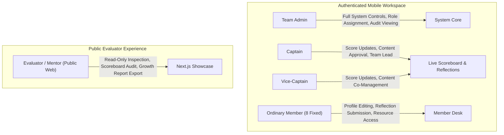

# ZENITH — Team No. 5 | Product Requirements Document (PRD)

| **Document Version** | 1.0.0 |
| **Status** | Approved for Architecture / Pending Implementation |
| **Project Name** | ZENITH — Team No. 5 |
| **Program** | mPOWER Placement Training Program |
| **Target Audience** | Team 5 Members, Team Leadership, Program Evaluators / Mentors |

---

## 1. Executive Summary & Objective

The **ZENITH — Team No. 5** application is a premium cross-platform mobile application and companion web showcase engineered for the **mPOWER Placement Training Program**. The primary objective is to deliver a production-grade, highly reliable, and visually captivating digital ecosystem that tracks the team's live competitive standing, documents the intensive 4-day placement curriculum, showcases team member profiles and competencies, and offers an exclusive, read-only companion interface for program evaluators and mentors.

The system is strictly designed for real-world live demonstration:
- Real-time scoreboard synchronization across physical Android and iOS devices.
- Fully enforceable server-side authorization and auditability.
- High-contrast, executive dark-navy visual styling.
- Zero mock or fabricated personal data; all unverified attributes are represented by standardized placeholder conventions.

---

## 2. User Personas & Permissions Overview

The system recognizes four authenticated mobile roles and one unauthenticated web role:

### Persona 1: Team Admin
- **Description:** Designated member responsible for workspace configuration, user account provisioning, role maintenance, and system governance.
- **Key Responsibilities:** Managing the 8 member account records, monitoring audit trails, enforcing data hygiene.

### Persona 2: Captain
- **Description:** Tactical team leader of Team No. 5.
- **Key Responsibilities:** Editing and validating competition scores for all competing groups, submitting authoritative team milestones, endorsing public showcase materials.

### Persona 3: Vice-Captain
- **Description:** Operational co-lead of Team No. 5.
- **Key Responsibilities:** Collaborating with Captain on live score updates, logging score adjustments, assisting in milestone documentation.

### Persona 4: Team Member (8 Authorized Accounts Total)
- **Description:** The 8 enrolled candidates comprising Team No. 5 in the mPOWER Placement Training Program.
- **Key Responsibilities:** Updating personal skills and career goals, submitting daily reflections across the 4 training days, accessing shared study resources and the event photo gallery.

### Persona 5: Program Evaluator / Mentor
- **Description:** External corporate trainers, placement officers, and evaluation jury assessing team engagement, technical caliber, and collaboration.
- **Key Responsibilities:** Reviewing team progress on a zero-friction, read-only web portal, viewing score standing, examining the 4-day curriculum journey, downloading the team growth dossier.

---

## 3. Detailed Functional Requirements

### 3.1 Authentication & Workspace Access
- **FR-01: Native Mobile Experience:** The application must run natively on iOS and Android platforms via Expo (React Native) with fluid 60fps animations, native keyboard handling, and system safe-area insets.
- **FR-02: Login-First Private Workspace:** The mobile client is strictly gated behind an authentication screen. Unauthenticated sessions are barred from viewing any internal data or routes.
- **FR-03: Closed Account Provisioning:**
  - Exactly 8 authorized member accounts exist in the workspace.
  - Self-service or public user registration is explicitly disabled at the database and identity provider levels.
  - Accounts are pre-provisioned with authorized institutional credentials.
- **FR-04: Role-Based Authorization:** Permissions for Team Admin, Captain, Vice-Captain, and ordinary members are strictly enforced at the database level via PostgreSQL Row Level Security (RLS). Roles can be reassigned only by the Team Admin.

### 3.2 Competition Scoreboard & Realtime Sync
- **FR-05: Live mPOWER Competition Scoreboard:**
  - Displays all competing groups in the placement cohort (e.g., Group 1 through Group N, prominently featuring ZENITH Team 5).
  - Presents rank, group name, total points, penalty deductions, bonus tallies, and last-updated indicators.
  - Includes a podium highlight for the top 3 teams and persistent pinned visibility for ZENITH Team 5.
- **FR-06: Restricted Score Editing:**
  - Modification of group points is strictly restricted to the **Captain** and **Vice-Captain**.
  - All score updates require an audit reason (e.g., "Day 2 Technical Quiz Round 1", "Aptitude Speed Challenge Bonus").
  - An append-only transaction ledger records every score modification with user ID, timestamp, and delta.
- **FR-07: Persistent Cross-Device Synchronization:**
  - Data updates broadcast immediately via Supabase Realtime (WebSockets) to all connected devices.
  - In the event of network disruption or WebSocket disconnection, the client executes an exponential backoff reconnect and synchronizes state via background polling.

### 3.3 Team Profiles & Competencies
- **FR-08: Team Directory & Profiles:**
  - Dedicated profile cards for each of the 8 members.
  - Fields include: Full Name, Role Badge, Primary Technical Skills, Soft Skills, Placement Target, Bio, Social Links (LinkedIn, GitHub), and Profile Image.
  - **Placeholder Policy:** Where official member assets or personal credentials are not yet supplied, standardized badges `[Pending Official Verification]` are displayed. Invented or synthetic data is prohibited.
  - Members may edit their own profile bio, skill tags, and portfolio links.

### 3.4 Four-Day mPOWER Training Journey
- **FR-09: Structured Curriculum Tracking:**
  - Day 1: Aptitude Mastery & Soft Skills Foundation.
  - Day 2: Technical Deep Dive & Coding Competency.
  - Day 3: Mock Interviews, GDs & Behavioral Dynamics.
  - Day 4: Grand Evaluation, Final Showcase & Placement Readiness.
  - Each day details: Learning Objectives, Daily Schedule, Speaker/Trainer Details, Key Metrics, and Status (`Upcoming`, `In Progress`, `Completed`).

### 3.5 Reflections, Document Management & Media Gallery
- **FR-10: Member Daily Reflections:**
  - Members log structured daily reflections: Key Takeaways, Challenges Encountered, Corrective Action Items, and Self-Assessment Rating (1–5 scale).
- **FR-11: Training Resources & File Management:**
  - Secure storage for placement cheat sheets, aptitude formulae, resume templates, and lecture slides.
  - Files are tagged with access classification: `Internal Workspace` vs `Showcase Approved`.
- **FR-12: Media Gallery:**
  - Captures team training sessions, whiteboard work, certificates, and group activities.
  - Captain and Admin can flag verified items as `Featured in Public Showcase`.

### 3.6 Companion Evaluator Web Showcase
- **FR-13: Public Evaluator Presentation Portal:**
  - Standalone Next.js companion web application accessible via a public web URL.
  - Zero login required for evaluators; displays only curated, approved data (`is_approved_for_showcase = true`).
  - Interactive components: Live Scoreboard Widget, 4-Day Journey Walkthrough, Team Member Grid, Curated Gallery, and Evaluator Feedback submission modal.
- **FR-14: Growth Dashboard & Report Dossier:**
  - Aggregates team point progression, skill acquisition radar, daily reflection milestones, and attendance fidelity.
  - Enables one-click generation and printing/downloading of an executive PDF Growth Dossier for evaluation panels.

### 3.7 UI System & Interaction States
- **FR-15: Complete Interaction State Coverage:**
  - Every screen explicitly implements:
    1. **Loading State:** Shimmering dark-mode skeleton loaders matching exact card geometries.
    2. **Empty State:** High-contrast illustration/icon, contextual explanation, and call-to-action button.
    3. **Success State:** Non-intrusive toast notifications and haptic response.
    4. **Error State:** Human-readable recovery messages with a "Retry Connection" action.

---

## 4. Non-Functional Requirements (NFRs)

### 4.1 Performance & Latency
- **NFR-01:** Cold app launch to interactive home feed in $\le 2.0$ seconds on modern mid-tier devices.
- **NFR-02:** Live score update broadcast to mobile client render within $\le 500\text{ ms}$ over 4G/Wi-Fi.
- **NFR-03:** Web showcase Lighthouse scores $\ge 90$ across Performance, Accessibility, Best Practices, and SEO.

### 4.2 Security & Compliance
- **NFR-04:** Zero unencrypted client credentials; tokens stored in hardware-backed secure storage (`Expo SecureStore`).
- **NFR-05:** Database access enforced via PostgreSQL Row Level Security (RLS) with explicit policies; zero reliance on client-side filtering.
- **NFR-06:** Secret keys (Supabase Service Role Key) strictly isolated from client builds and public bundles.

### 4.3 Reliability & Availability
- **NFR-07:** Offline-first caching for static curriculum content and member profiles using client-side cache persistence.
- **NFR-08:** Graceful degradation on network failure, displaying last known cached standings with an "Offline" badge.

### 4.4 Accessibility & Ergonomics
- **NFR-09:** WCAG 2.1 Level AA color contrast compliance across all text and icon components.
- **NFR-10:** Minimum touch target size of $48 \times 48\text{ dp}$ for all interactive elements.

---

## 5. Scope Boundaries

| In-Scope for Project | Out-of-Scope (Strictly Excluded) |
| :--- | :--- |
| Mobile app for Android and iOS (Expo) | Native desktop applications (Windows/macOS) |
| Companion Next.js Evaluator Web Portal | Self-service public user registration |
| Exactly 8 pre-provisioned member accounts | Payment processing or monetization modules |
| Live Supabase Realtime scoreboard sync | Full video conferencing / live stream streaming |
| Captain/Vice-Captain score editing & audit logs | Custom machine learning model training |
| Standardized placeholder assets for unverified data | Invented/fictitious member names and achievements |
