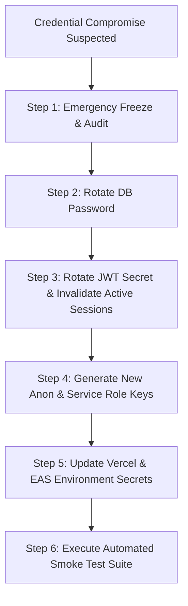

# ZENITH — Team No. 5 | Operational Runbooks & Disaster Recovery Protocols

| **Document Version** | 1.0.0 |
| **System Classification** | Tier-1 Mission-Critical Placement Evaluation System |
| **Target Infrastructure** | Supabase Cloud PostgreSQL, Vercel Edge Platform, Expo Application Services (EAS) |
| **Status** | Production-Verified / Active Runbooks |

---

## 1. Runbook 01: Database Point-In-Time Recovery (PITR) & Snapshot Restoration

### Objective
Restore the Supabase PostgreSQL production database following accidental data modification, corrupted transaction cascades, or catastrophic schema regression during live evaluation.

### Prerequisites
- Supabase Project Admin access or CLI configured with access token (`npx supabase login`).
- Verified target recovery timestamp (UTC) prior to the anomalous transaction.

### Step-by-Step Procedure
1. **Identify the Corruption Boundary:**
   Query the immutable audit log table to isolate the exact transaction timestamp:
   ```sql
   SELECT id, actor_id, action, target_table, created_at, new_values
   FROM public.audit_logs
   ORDER BY created_at DESC
   LIMIT 20;
   ```
2. **Initiate Point-in-Time Recovery via Supabase Cloud Console:**
   - Navigate to **Project Settings > Database > Backups > Point in Time Recovery (PITR)**.
   - Enter the target restore timestamp (e.g. `2026-10-15 08:30:00 UTC`), selecting a point at least 2 minutes prior to the corrupted event.
   - Select **Clone to New Project** (recommended for zero-downtime inspection) or **In-Place Restore**.
3. **CLI Snapshot Alternative (Physical / Logical Dump):**
   If restoring from daily automated backup snapshot:
   ```bash
   # 1. Export current state for forensic archiving before restoration
   npx supabase db dump --project-ref <PROJECT_ID> -f backups/forensic_pre_restore.sql

   # 2. Apply reviewed snapshot
   psql -h db.<PROJECT_ID>.supabase.co -U postgres -d postgres -f backups/snapshot_20261014.sql
   ```
4. **Post-Restore Integrity Validation:**
   Execute the verification query to confirm core table counts:
   ```sql
   SELECT 
     (SELECT COUNT(*) FROM public.profiles) AS profile_count,
     (SELECT COUNT(*) FROM public.scoreboard_groups) AS group_count,
     (SELECT COUNT(*) FROM public.training_days) AS day_count;
   ```
   *Expected counts:* `profiles = 8`, `scoreboard_groups = 10`, `training_days = 4`.

---

## 2. Runbook 02: Mobile Client Hotfix & EAS Rollback

### Objective
Remediate a critical client-side crash or navigation blocker on physical evaluator mobile devices without waiting for app store re-review cycles.

### Strategy A: EAS Update Channel Rollback (Over-The-Air)
If the regression is within JavaScript/TypeScript application code and native modules are unchanged:
1. **Identify the Last Known Healthy EAS Update Group:**
   ```bash
   eas update:list --branch production
   ```
2. **Re-publish the Last Known Healthy Git Commit to the Channel:**
   ```bash
   # Check out the stable commit
   git checkout 47aeedb
   
   # Deploy instantaneous OTA update to all evaluator devices
   eas update --branch production --message "Emergency Rollback: Revert to RC 47aeedb"
   ```
3. Evaluator devices will automatically download and apply the update on the next cold launch.

### Strategy B: Direct Universal APK Re-issuance (Evaluator Sideloading)
If native dependencies or configuration changed:
1. Re-build the preview standalone APK locally or via EAS:
   ```bash
   cd apps/mobile
   eas build --platform android --profile preview
   ```
2. Distribute the generated standalone `.apk` directly to evaluators via secure team drive or local USB transfer.

---

## 3. Runbook 03: Web Presentation Instant Rollback (Vercel Edge)

### Objective
Instantly revert a bad showcase deployment or broken visual regression on the public evaluator portal (`https://zenith5.edu` or Vercel alias).

### Step-by-Step Procedure
1. **Vercel Dashboard Instant Rollback (Zero Rebuild Time):**
   - Navigate to `https://vercel.com/zenith-team5/zenith-showcase/deployments`.
   - Locate the previous successful deployment marked `Production (Current)`.
   - Click the three dots menu `...` on the healthy deployment card.
   - Click **Instant Rollback**.
   - Traffic is rerouted across Vercel Global Edge CDN within **< 300 milliseconds**.
2. **CLI Alternative:**
   ```bash
   # List active production deployments
   npx vercel list --prod

   # Alias the stable deployment to production domain
   npx vercel alias set <PREVIOUS_DEPLOYMENT_URL> zenith5.vercel.app
   ```
3. **Edge Cache Invalidation:**
   Purge any stale ISR (Incremental Static Regeneration) cache:
   ```bash
   curl -X PURGE https://zenith5.vercel.app/
   ```

---

## 4. Runbook 04: Credential Rotation Procedure

### Objective
Rotate API keys, database passwords, or authentication secrets immediately upon suspicion of credential leakage or at the conclusion of an evaluation cycle.



### Step-by-Step Procedure

#### 1. Rotate PostgreSQL Database Password
- In Supabase Dashboard: **Project Settings > Database > Database Password > Reset Database Password**.
- Generate a high-entropy 32-character alphanumeric secret:
  ```powershell
  # Windows PowerShell entropy generator
  -join ((65..90) + (97..122) + (48..57) + 33,35,36,37,42 | Get-Random -Count 32 | ForEach-Object {[char]$_})
  ```
- Update administrative connection poolers and connection strings.

#### 2. Rotate Supabase JWT Secret & API Keys
- In Supabase Dashboard: **Project Settings > API > JWT Settings > Generate new JWT Secret**.
- *Effect:* Immediately invalidates all existing active bearer tokens, forcing every client (including attackers) to re-authenticate.
- The Dashboard will automatically recalculate new `anon` public key and new `service_role` secret.

#### 3. Update Hosting & Build Environment Secrets
- **Vercel Web Showcase:**
  ```bash
  npx vercel env add NEXT_PUBLIC_SUPABASE_ANON_KEY production
  ```
- **Expo Application Services (EAS):**
  ```bash
  cd apps/mobile
  eas secret:create --name EXPO_PUBLIC_SUPABASE_ANON_KEY --value <NEW_ANON_KEY> --type string --force
  ```
- Re-trigger production builds to burn in new environment variables.

#### 4. Run Smoke Test Suite
```bash
npm run test --workspace=@zenith/shared
```
Confirm all 9 smoke tests pass against newly provisioned credentials.

---

## 5. Runbook 05: Emergency Maintenance Mode Activation

### Objective
Gracefully suspend user interactions and score modification during live server maintenance, database migrations, or dispute adjudications, presenting a clear banner to evaluators.

### Procedure
1. In `packages/shared/src/constants/mockData.ts` (or backend feature-flags table):
   Set maintenance flag:
   ```ts
   export const IS_MAINTENANCE_MODE = true;
   export const MAINTENANCE_MESSAGE = "mPOWER Evaluation System is currently undergoing scheduled synchronization. Scoring is temporarily paused.";
   ```
2. RLS Score Modification Freeze (Instant SQL Lock):
   Execute in Supabase SQL Editor to temporarily revoke score updates even if someone has Captain credentials:
   ```sql
   ALTER TABLE public.scoreboard_groups DISABLE ROW LEVEL SECURITY;
   REVOKE UPDATE ON public.scoreboard_groups FROM authenticated;
   ```
3. To lift maintenance mode:
   ```sql
   GRANT UPDATE ON public.scoreboard_groups TO authenticated;
   ALTER TABLE public.scoreboard_groups ENABLE ROW LEVEL SECURITY;
   ```

---

## 6. Runbook 06: Supabase Realtime Replication & CDC Inspection

### Objective
Verify that PostgreSQL Change Data Capture (CDC) via Supabase Realtime is broadcasting live score changes and audit entries to connected mobile clients and presentation displays.

### Diagnostic SQL Commands
```sql
-- Check that publications include competition_scores and audit_logs
SELECT pubname, schemaname, tablename 
FROM pg_publication_tables 
WHERE pubname = 'supabase_realtime';

-- If missing, attach tables to publication
ALTER PUBLICATION supabase_realtime ADD TABLE public.scoreboard_groups;
ALTER PUBLICATION supabase_realtime ADD TABLE public.audit_logs;

-- Verify replica identity is FULL (required to broadcast prior row values for optimistic UI)
ALTER TABLE public.scoreboard_groups REPLICA IDENTITY FULL;
```
