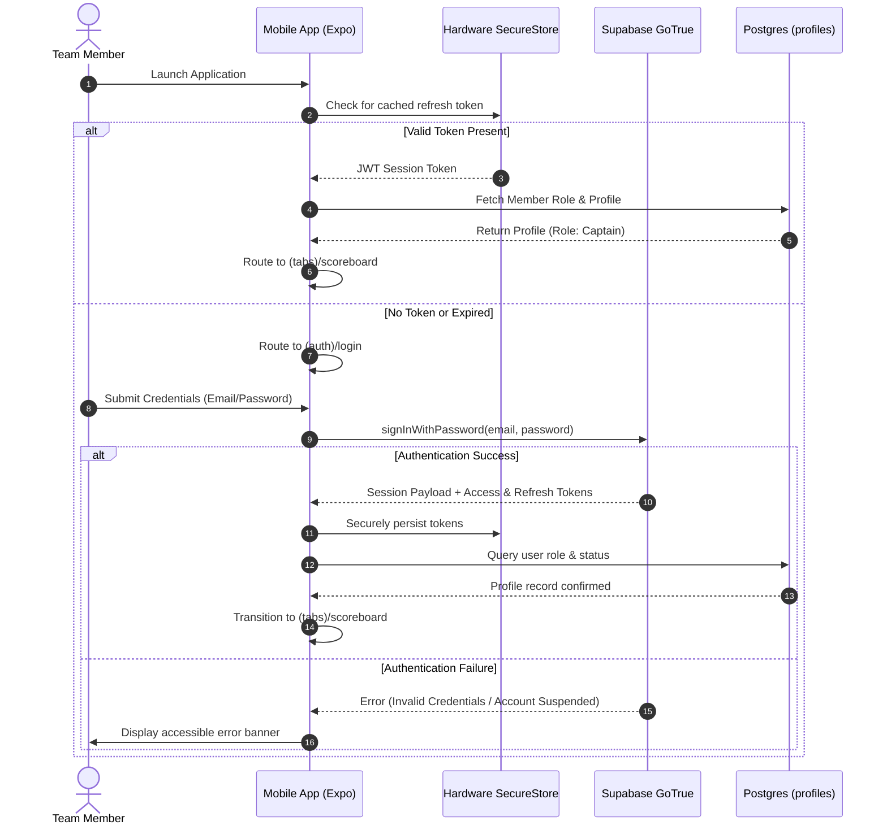
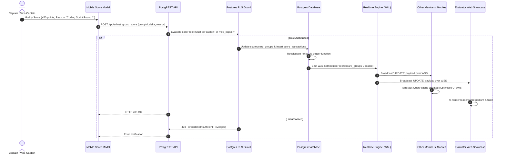

# ZENITH — Team No. 5 | Technical Architecture Specification

| **Document Version** | 1.0.0 |
| **Status** | Approved for Architecture / Pending Implementation |
| **System** | ZENITH Unified Ecosystem (Mobile App + Evaluator Showcase + Supabase) |

---

## 1. System Overview & Architectural Topology

The ZENITH ecosystem is structured as an integrated monorepo comprising a native cross-platform mobile client for team members, a server-rendered companion web portal for program evaluators, and a managed PostgreSQL backend powered by Supabase.

```mermaid
graph TB
    subgraph Client Layer
        MOB["ZENITH Mobile App (Expo / React Native)<br/>• Target: Android & iOS<br/>• Users: 8 Enrolled Team Members<br/>• Session: SecureStore JWT"]
        WEB["Evaluator Showcase (Next.js App Router)<br/>• Target: Desktop & Mobile Browsers<br/>• Users: Program Evaluators & Mentors<br/>• Session: Anonymous Public Read"]
    end

    subgraph Edge & API Gateway
        S_AUTH["Supabase Auth (GoTrue)<br/>• Email/Password<br/>• Closed Provisioning"]
        S_REAL["Supabase Realtime Engine<br/>• Postgres CDC<br/>• WebSockets / WSS"]
        S_REST["PostgREST API Gateway<br/>• Auto-generated REST<br/>• RLS Policy Enforcement"]
        S_STOR["Supabase Storage S3<br/>• Private Member Bucket<br/>• Public Showcase Bucket"]
    end

    subgraph Data & Persistence Layer
        PG[("PostgreSQL 15+ Database Engine")]
        RLS["PostgreSQL Row Level Security (RLS)<br/>• Role Verification<br/>• Captain/Admin Scopes"]
        AUDIT["Immutable Audit Trigger & Ledger"]
    end

    MOB -->|Auth Requests| S_AUTH
    MOB -->|WSS Realtime Subscriptions| S_REAL
    MOB -->|Data Operations (REST)| S_REST
    MOB -->|Secure File Uploads| S_STOR

    WEB -->|Read Public Endpoints| S_REST
    WEB -->|Read Approved Media| S_STOR
    WEB -->|Live Standings Feed| S_REAL

    S_REST --> RLS
    RLS --> PG
    PG --> AUDIT
    PG -->|WAL Change Events| S_REAL
```

---

## 2. Monorepo Repository Structure

The workspace utilizes an enterprise npm/turborepo workspace structure, ensuring clean separation of concerns while facilitating code and type sharing:

```text
ZENITH-app/
├── .github/                      # CI/CD Workflows (lint, typecheck, test, EAS trigger)
│   └── workflows/
│       ├── test.yml
│       └── release.yml
├── apps/
│   ├── mobile/                   # React Native Expo Application
│   │   ├── app/                  # Expo Router File-Based Navigation
│   │   │   ├── (auth)/           # Authentication route group (login, reset)
│   │   │   ├── (tabs)/           # Authenticated bottom tab layout
│   │   │   │   ├── scoreboard/   # Live Competition Standings & Score Editor Modal
│   │   │   │   ├── journey/      # 4-Day Curriculum & Daily Timeline
│   │   │   │   ├── reflections/  # Daily Reflection Forms & History
│   │   │   │   ├── team/         # Team Directory & Individual Member Profiles
│   │   │   │   └── resources/    # Documents, Storage & Photo Gallery
│   │   │   ├── modals/           # Captain Score Update Modal, Filter Modals
│   │   │   └── _layout.tsx       # Root Layout, Auth Guards, Query Provider
│   │   ├── assets/               # Local splash screens, vector icons, placeholders
│   │   ├── src/
│   │   │   ├── components/       # UI Atoms, Molecules, Organisms (Design System)
│   │   │   ├── hooks/            # Custom React hooks (useScoreboard, useAuth)
│   │   │   ├── services/         # Supabase client singleton, API client
│   │   │   └── utils/            # Local storage, date formatters, haptics
│   │   ├── app.json              # Expo configuration (plugins, bundle ID, schemes)
│   │   ├── eas.json              # EAS Build profiles (development, preview, production)
│   │   ├── tsconfig.json
│   │   └── package.json
│   │
│   └── showcase/                 # Evaluator Companion Web Portal (Next.js)
│       ├── src/
│       │   ├── app/              # Next.js App Router (RSC & Client components)
│       │   │   ├── page.tsx      # Executive Overview & Live Scoreboard
│       │   │   ├── journey/      # Interactive 4-Day Curriculum Walkthrough
│       │   │   ├── team/         # Public Team 5 Member Roster & Skills
│       │   │   ├── gallery/      # Verified Showcase Media Grid
│       │   │   ├── report/       # Downloadable/Printable Growth Dossier
│       │   │   └── layout.tsx    # Header, Navigation, Footer, Dark Theme
│       │   ├── components/       # Web UI components (Tailwind CSS, Radix UI)
│       │   └── lib/              # Supabase server client, public data fetchers
│       ├── public/               # Static assets & placeholder images
│       ├── next.config.js
│       ├── tailwind.config.js
│       ├── tsconfig.json
│       └── package.json
│
├── packages/
│   ├── shared/                   # Shared TypeScript Core
│   │   ├── src/
│   │   │   ├── types/            # Database entities, DTOs, Enums
│   │   │   ├── schemas/          # Zod validation schemas (forms, mutations)
│   │   │   ├── constants/        # Score rules, training days metadata, theme tokens
│   │   │   └── formatters/       # Date, point, and string formatters
│   │   ├── tsconfig.json
│   │   └── package.json
│   │
│   └── config/                   # Shared Linting & TypeScript Base Configs
│       ├── eslint-preset.js
│       └── tsconfig.base.json
│
├── supabase/                     # Supabase Configuration & Migrations
│   ├── migrations/               # DDL SQL files, RLS policies, triggers
│   │   ├── 20261014000001_initial_schema.sql
│   │   ├── 20261014000002_rls_policies.sql
│   │   └── 20261014000003_seed_data.sql
│   ├── seed.sql                  # Initial groups and placeholder team structure
│   └── config.toml               # Supabase local environment config
│
├── docs/                         # Formal Architectural & Project Documentation
├── .env.example                  # Safe template for environment variables
├── .gitignore
├── package.json                  # Monorepo root workspace configuration
└── README.md
```

---

## 3. Technology Stack & Decision Matrix

| Layer | Selected Technology | Version | Architectural Justification |
| :--- | :--- | :--- | :--- |
| **Mobile Runtime** | React Native / Expo | SDK 52+ | Rapid cross-platform native execution, deep hardware bridge, seamless EAS build pipeline. |
| **Mobile Routing** | Expo Router | v4+ | Type-safe, file-system based routing aligning deep-linking, tab bars, and nested modal stacks. |
| **Web Runtime** | Next.js App Router | v15+ | React Server Components for zero-bundle initial load, SEO/evaluator performance, and fast Vercel edge deployment. |
| **Language** | TypeScript | v5.3+ | Strict type safety enforced across mobile, web, and shared schema contracts. |
| **Data & Auth** | Supabase (PostgreSQL) | v15+ | Managed relational persistence, built-in GoTrue authentication, and declarative Row Level Security. |
| **Realtime Engine** | Supabase Realtime | v2+ | Native Postgres Logical Replication broadcast over WebSockets, minimizing server maintenance. |
| **State Management** | TanStack Query (React Query) | v5+ | Automatic server-state caching, background revalidation, optimistic updates, and offline fallback. |
| **Client Storage** | `expo-secure-store` | Latest | Hardware-backed key-value storage for mobile JWT session persistence. |
| **Validation** | Zod | v3.22+ | Isomorphic schema validation between UI inputs, API calls, and database models. |

---

## 4. Key Data Flow Sequences

### 4.1 Authentication & Gated Session Lifecycle



### 4.2 Realtime Scoreboard Broadcast & Synchronization



### 4.3 Resilience & Polling Fallback Architecture

To guarantee high availability during live presentations under unpredictable auditorium network conditions:

1. **Primary Transport:** Supabase Realtime channel listening to table changes on `scoreboard_groups`.
2. **Heartbeat Monitoring:** Client periodically inspects WebSocket connection state (`SUBSCRIBED`, `CLOSED`, `CHANNEL_ERROR`).
3. **Automatic Fallback:** If the WebSocket state disconnects or emits a timeout, TanStack Query activates background HTTP polling with an interval of **10 seconds**.
4. **Reconnection:** When WebSocket connectivity is restored, background polling ceases, and the client receives push events instantly.
