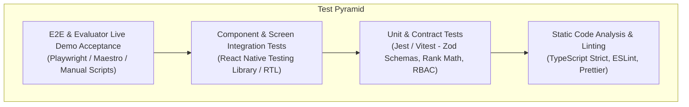

# ZENITH — Team No. 5 | Quality Assurance & Test Plan

| **Document Version** | 1.0.0 |
| **Status** | Approved for Architecture / Pending Implementation |
| **Scope** | Static Analysis, Unit, Integration, Component, E2E & Evaluator Acceptance Testing |

---

## 1. Testing Strategy & Pyramid

1. **Static Analysis & Type Integrity:**
   - Strict TypeScript (`"strict": true`, zero `any` policy in shared contracts).
   - ESLint with React Native and Next.js recommended rulesets.
2. **Unit & Logic Testing:**
   - Validating pure calculation logic: Rank recalculation algorithm, point deltas, date formatters.
   - Schema validation: Zod parsing for reflection forms, score inputs, and auth payloads.
3. **Integration & Security Testing:**
   - PostgreSQL RLS policy verification ensuring unauthorized users cannot bypass UI guards.
   - Authentication state machine transitions.
4. **Component & Interaction Testing:**
   - React Native Testing Library verifying screen rendering across loading, error, empty, and populated states.
5. **Evaluator Demonstration Script (Acceptance Testing):**
   - Step-by-step verification verifying that the live demo functions without crashes or delays.

---

## 2. Test Cases Specification Matrix

| Test ID | Category | Objective / Scenario | Expected Result | Pass/Fail Criteria |
| :--- | :--- | :--- | :--- | :--- |
| **TC-AUTH-01** | Auth | Login with valid pre-provisioned credentials. | Stores session token in SecureStore; navigates to `(tabs)/scoreboard`. | Navigates without delay; user profile populated. |
| **TC-AUTH-02** | Auth | Login with invalid password. | Renders accessible error banner; zero route navigation. | HTTP 400 caught; no unhandled promise rejection. |
| **TC-AUTH-03** | Auth | Attempting self-service registration. | Fails with explicit error; endpoint disabled at API gateway. | HTTP 403 Forbidden received. |
| **TC-RBAC-01** | RBAC | Captain / Vice-Captain accessing score editor. | Score modification action button is visible and active. | Modal opens with score delta controls. |
| **TC-RBAC-02** | RBAC | Ordinary member attempting score modification. | Score modification button is hidden; direct RPC call rejected by RLS. | Postgres raises `Access Denied` exception. |
| **TC-SCORE-01**| Score | Submitting score delta (`+50` points). | Updates `current_points`, recomputes `rank`, updates podium. | Group net points increase by 50; rank reordered. |
| **TC-SCORE-02**| Score | Score audit ledger generation. | Insertion into `score_transactions` with `actor_id` and reason. | Record verified in database with timestamp. |
| **TC-SYNC-01** | Realtime | Broadcast across multiple mobile clients. | Score change on Device A updates Device B within 500ms. | WebSocket message consumed; TanStack Query cache updated. |
| **TC-SYNC-02** | Resilience| Simulating network drop / WebSocket failure. | Client gracefully transitions to 10-second polling fallback. | Standings remain visible; offline badge displayed. |
| **TC-CURR-01** | Curriculum | 4-Day Journey navigation. | Displays Day 1 through Day 4 with status tags and focus areas. | All days render cleanly with milestone markers. |
| **TC-REFL-01** | Reflections| Member submits daily reflection. | Validates minimum length (10 chars); saves to database. | Record saved; viewable in member reflection list. |
| **TC-REFL-02** | Showcase | Captain approves reflection for showcase. | Sets `is_approved_for_showcase = true`; appears on public web. | Evaluator web portal can query the approved item. |
| **TC-SHOW-01** | Showcase | Evaluator accesses public companion web portal. | Loads public dashboard without authentication prompts. | Fast initial paint ($\le 1.5\text{s}$); read-only standings visible. |
| **TC-SHOW-02** | Report | Evaluator generates Growth Dossier report. | Generates printable / PDF view of team metrics. | Clean document layout with metrics summary. |

---

## 3. Evaluator Demonstration Checklist

Prior to entering the live presentation room, execute this verification run:

- [ ] **Device 1 (Android):** Signed in as **Captain** (`captain@zenith5.edu`).
- [ ] **Device 2 (iOS):** Signed in as **Ordinary Member** (`member1@zenith5.edu`).
- [ ] **Device 3 / Projector (Laptop Browser):** Connected to **Evaluator Companion Showcase** (`https://showcase.zenith5.edu`).
- [ ] **Live Score Test:**
  - On Device 1, open Score Editor, add `+25` points for ZENITH (Team 5) with reason `"Live Demo Evaluation"`.
  - Confirm immediate update on Device 2 (Member mobile) within $<1$ second.
  - Confirm immediate update on Laptop Browser (Public Showcase) without manual browser refresh.
- [ ] **RBAC Verification:**
  - Verify Device 2 (Member) has NO edit button on the scoreboard.
- [ ] **Journey & Reflection Verification:**
  - Open Day 2 in mobile; inspect reflection submission form.
- [ ] **Dossier Generation:**
  - Open Showcase Report page; click "Export Growth Dossier"; confirm PDF layout renders properly.
