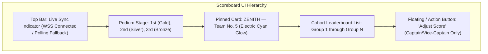

# ZENITH — Team No. 5 | UI/UX Design System Specification

| **Document Version** | 1.0.0 |
| **Status** | Approved for Architecture / Pending Implementation |
| **Visual Direction** | Executive Dark Navy with Electric-Blue, Cyan, and Gold Accents |

---

## 1. Visual Identity & Brand Philosophy

The **ZENITH** design system evokes high-performance leadership, competitive focus, and engineering elegance. Built specifically for executive evaluator presentations and daily team collaboration, it blends the legibility of a financial Bloomberg terminal with the sleek ergonomics of modern developer tools.

```text
Visual Tone:  Executive • Confident • Precise • High-Contrast
Theme Mode:   Dark Mode First (Navy Core)
Accents:      Electric Blue (Action/Focus) • Cyan (Data/Metrics) • Gold (Leader/Victory)
```

---

## 2. Color Palette & Design Tokens

### 2.1 Background & Surface Hierarchy

| Token Name | Hex Code | Visual Description & Usage |
| :--- | :--- | :--- |
| `background-deep` | `#050814` | True base background for root viewports and splash screens |
| `background-navy` | `#0A1128` | Primary surface background for mobile screens and web page body |
| `surface-card` | `#101C3D` | Elevated container surface for cards, list items, and widgets |
| `surface-card-hover` | `#15244C` | Interactive hover/press state for elevated containers |
| `surface-elevated` | `#1C2E60` | Modals, bottom sheets, dropdown menus, and popovers |
| `border-subtle` | `#1E3368` | 1px border dividers, card contours, input boundaries |
| `border-accent` | `#2D4B94` | Focused border state for inputs and highlighted cards |

### 2.2 Brand & Semantic Accents

| Token Name | Hex Code | Visual Description & Usage |
| :--- | :--- | :--- |
| `brand-electric` | `#2563EB` | Primary brand accent; call-to-action buttons, active tab indicators |
| `brand-electric-glow` | `#3B82F6` | Shimmer effects, glowing pill badges, active focus rings |
| `brand-cyan` | `#06B6D4` | Data visualization curves, secondary stats, timeline progress lines |
| `brand-cyan-light` | `#22D3EE` | Skill tag chips, live status pulse dots, metrics highlights |
| `accent-gold` | `#F59E0B` | #1 Rank badge, podium gold crown, competition awards |
| `accent-gold-bright` | `#FBBF24` | Cumulative point badges, winner highlights |
| `semantic-success` | `#10B981` | Positive point deltas (`+50`), completed task indicators |
| `semantic-danger` | `#EF4444` | Penalty deductions (`-20`), error banners, destructive modals |
| `semantic-warning` | `#F97316` | Pending approvals, warning notifications |

### 2.3 Typography & Contrast Hierarchy

All typography enforces strict WCAG 2.1 AA compliance ($\ge 4.5:1$ contrast ratio against dark navy surfaces).

| Scale Token | Font Size / Line Height | Weight | Application |
| :--- | :--- | :--- | :--- |
| `text-display` | $36\text{ px} / 44\text{ px}$ | Heavy (800) | Major scoreboard point tallies, hero metric displays |
| `text-h1` | $28\text{ px} / 34\text{ px}$ | Bold (700) | Screen titles, podium rank numbers, major headers |
| `text-h2` | $22\text{ px} / 28\text{ px}$ | SemiBold (600) | Group names on cards, modal titles, section headers |
| `text-h3` | $18\text{ px} / 24\text{ px}$ | SemiBold (600) | Member names, day titles, widget subtitles |
| `text-body` | $15\text{ px} / 22\text{ px}$ | Regular (400) | Reflection text, descriptions, guidelines |
| `text-caption` | $13\text{ px} / 18\text{ px}$ | Medium (500) | Timestamps, metadata tags, input helper text |
| `text-mono` | $14\text{ px} / 20\text{ px}$ | SemiBold (600) | Point changes (`+50 pts`), ranks (`#05`), IDs |

---

## 3. Component Architecture & Specifications

### 3.1 The Live Scoreboard Component Suite



1. **Podium Component:**
   - 3 columns with staggered heights (Center: #1 Gold, Left: #2 Silver, Right: #3 Bronze).
   - Animated point counters updating smoothly when new points arrive.
2. **Pinned ZENITH Team Card:**
   - Always visible at the top or sticky bottom of the leaderboard view.
   - Distinct electric-cyan 2px border with a soft drop-shadow (`box-shadow: 0 4px 20px rgba(6, 182, 212, 0.25)`).
   - High-contrast badge: **"TEAM NO. 5 • OUR TEAM"**.
3. **Scoreboard Group Card:**
   - Left: Rank circle badge with metallic gradient.
   - Middle: Group name, group number, and status indicator.
   - Right: Point total in heavy display font with mini trend pill showing change since previous session.
4. **Captain Score Editor Modal:**
   - Accessible strictly to Captain and Vice-Captain.
   - Numeric stepper input for score delta (`+` and `-`).
   - Mandatory reason text input with minimum 3-character validation.
   - Event category selector: `Aptitude Round`, `Coding Challenge`, `Mock Interview`, `Penalty Deduction`.

### 3.2 Four-Day Journey Timeline Cards

- **Interactive Vertical Stepper:**
  - Connecting vertical electric-blue line linking Day 1 through Day 4.
  - Active pulse indicator for the current live day.
  - Completed days display an emerald check badge.
- **Card Content:**
  - Date and day index (`DAY 01`, `DAY 02`, etc.).
  - Objective statement and key technical focus areas represented as pill tags (`#DSA`, `#SystemDesign`, `#Aptitude`).
  - Quick action: "View Day Reflections" and "Access Resources".

### 3.3 Team Directory & Member Profile Cards

- **Avatar Treatment:**
  - Circular avatar with 2px electric border.
  - When official portrait is absent, renders a clean SVG monogram placeholder with the badge `[Official Photo Pending]`.
- **Role Badges:**
  - `Team Admin`: Purple / Electric gradient badge.
  - `Captain`: Gold / Amber gradient badge with star icon.
  - `Vice-Captain`: Cyan / Slate gradient badge with chevron icon.
  - `Member`: Navy / Steel badge with check icon.
- **Skill Chips:**
  - Rounded pills with dark navy background, subtle cyan border, and bright cyan text.

---

## 4. Interaction States & Edge Case Specifications

Every UI component adheres to a comprehensive four-state model:

```text
┌────────────────────────────────────────────────────────────────────────┐
│                        COMPREHENSIVE UI STATES                         │
├───────────────────┬───────────────────┬────────────────────────────────┤
│ 1. LOADING STATE  │ Shimmer Skeleton  │ Matches exact card geometries; │
│                   │                   │ uses #101C3D -> #1C2E60 wave   │
├───────────────────┼───────────────────┼────────────────────────────────┤
│ 2. EMPTY STATE    │ Clean Placeholder │ Themed icon, descriptive text, │
│                   │                   │ and clear action button        │
├───────────────────┼───────────────────┼────────────────────────────────┤
│ 3. SUCCESS STATE  │ Dynamic Feedback  │ Subtle haptic tick, green ring,│
│                   │                   │ auto-dismissing toast (3s)     │
├───────────────────┼───────────────────┼────────────────────────────────┤
│ 4. ERROR STATE    │ Clear Recovery    │ Coral border, plain-language   │
│                   │                   │ explanation, "Retry" button    │
└───────────────────┴───────────────────┴────────────────────────────────┘
```

---

## 5. Placeholder & Unverified Asset Governance

To guarantee that no fabricated or synthetic data is displayed to evaluators:

1. **Logo & Identity:** Render official text **"ZENITH — Team No. 5"** alongside a geometric vector emblem labeled `[Official Emblem Pending Certification]`.
2. **Team Motto:** Displays `"[Official Team Motto Pending Formal Adoption]"`.
3. **Unverified Members:** Profiles without verified institutional rosters display placeholder names formatted as `[Candidate 01 — Pending Roster]` through `[Candidate 08 — Pending Roster]`.
4. **Member Bio & Social Links:** Formatted with informative placeholders: `[Official LinkedIn Profile Pending Verification]`.
